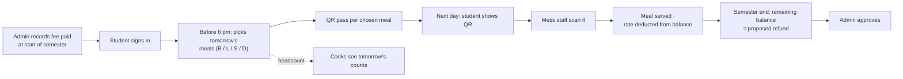

# Presenting the MNIT Mess Portal

## The one-minute pitch
> Hostel mess fees are prepaid, but students who skip meals still pay for them, and refunds at semester end are guesswork. Our portal makes the mess **pay-per-meal**: students say a day ahead which meals they will eat, get a **QR pass** for each, mess staff **scan the pass to serve**, and the meal's rate is deducted from their prepaid balance. At semester end the **remaining balance is the refund**, reviewed and approved by mess administration. The cooks also learn tomorrow's headcount in advance, which reduces food waste.

## The flow (draw this on the board)

## Live demo script (about 6 minutes)
Set-up beforehand (SETUP.md): Supabase project, migrations, seed, `npm run dev`. Open three browser windows (one normal, one private, one phone): **Admin**, **Manager**, **Student**.
Logins: **admin** = `jatishnarula8@gmail.com` (the only admin; sign up with it and confirm the email), plus demo accounts `manager@mnit.ac.in` and `student01@mnit.ac.in` (password `demo1234`).

1. **Admin panel (`/admin`, admin password).** Search *Aarav*. The table shows name, ID (roll no), email, phone and **money left**. Edit money left → Save; the change is added to an append-only ledger, never overwritten (Admin → Audit shows it). Scan QRs right here too, and see the day's scans below the scanner.
2. **Admin → Setup.** Show per-meal rates, meal timings and the **plan-ahead deadline**. (If you are demoing after 6 pm, set it to 23:59 so planning is still open.)
3. **Student (student01) → Plan tomorrow.** Choose Yes/No for the 4 meals → Save. Try changing your mind. *Point out:* after the deadline the page locks, and the database itself refuses late changes.
4. **Student → Today.** The seed has already given student01 QR passes for today's meals. Show the QR on a phone.
5. **Admin panel or Manager → Scan QR.** Scan the phone (or paste the code if no camera). Screen turns **green: "Serve: Lunch · Aarav Sharma"**. Scan it again → **red: already used**. Show a made-up code → red.
6. **Student → Wallet.** Balance dropped by the lunch rate; the ring shrinks; the meal appears in **Meal log**; the "projected refund" updates (labelled *proposed — pending approval*).
7. **Manager → Live.** Tomorrow's headcount per meal, and the cooked-vs-served chart.
8. **Admin → Refunds.** Close the semester → proposals appear → approve one → export the CSV. *Say clearly:* the system records the decision; the actual payout is done by the institute.
9. *(optional)* **Disputes:** student says "I ate but wasn't scanned" → manager approves with a reason → ledger entry + audit log.

## Why it is trustworthy (examples of questions to expect)
| Question | Answer |
|---|---|
| Can a student reuse or share a QR? | Each pass is single-use and tied to one student, meal and date. A second scan is refused, and the one-meal-per-student-per-meal rule is enforced in the database. |
| Can staff cheat or peek at money? | Staff can scan and resolve disputes but cannot read balances (Row Level Security). Every dispute decision and QR scan is audit-logged. |
| Can a student edit their balance? | No. The balance is the sum of an append-only ledger; even the database blocks updates and deletes. |
| What if someone has no balance? | The scan screen says "Do not serve". |
| What about students who forget to plan? | They get no QR for that day; the mess office can handle exceptions. (Policy choice, easy to change.) |
| Where does the fingerprint machine fit? | It is an **optional second channel**: the bridge in `bridge/` forwards eSSL punches to the same database, using the same one-meal-per-day rule. The QR flow works on its own with no hardware. |
| Privacy? | Only name, roll number, hostel and meal times. No biometric data is stored anywhere. First login shows a consent screen. |

## Tech stack to list on a slide
Next.js 14 (App Router) + TypeScript + Tailwind · Supabase (Postgres, Auth, Row Level Security, Edge Functions, Realtime) · business rules as SQL functions/triggers · Recharts · QR generation (`qrcode.react`) and scanning (`html5-qrcode`) · Node.js device bridge · automated tests (38 database tests, 8 bridge, 6 web).

## Be upfront about limits (professors respect this)
- Refunds are *proposals*; no money moves in the software.
- Tested on a Postgres engine locally; deploy to Supabase and run the SETUP step-7 check before demo day.
- Real eSSL machine support is written but needs testing on actual hardware (bridge/README checklist).
- ERP single-sign-on is future work and needs institute approval.
