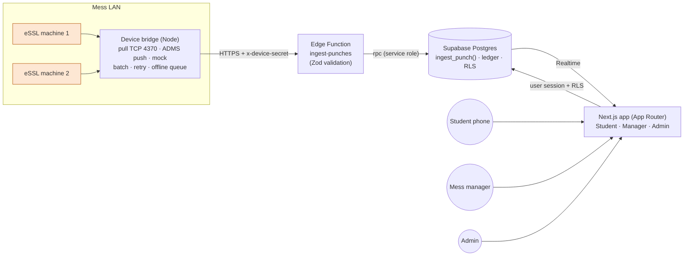
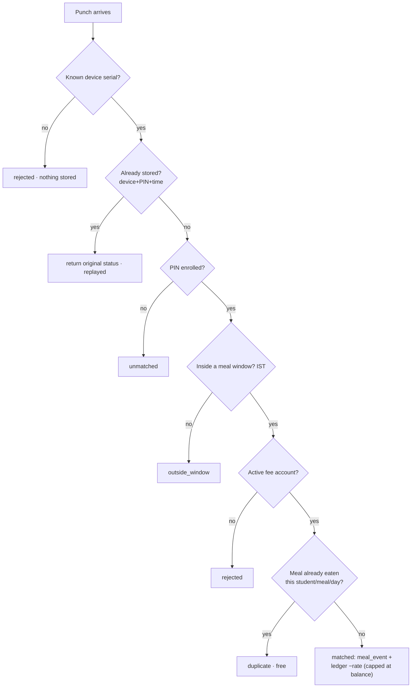

# MNIT Mess Portal

Biometric meal tracking + refund ledger for the hostel mess. Students prepay; every valid biometric punch is "a meal eaten" and takes that meal's rate off a refundable balance. At semester end the remaining balance becomes a **proposed refund (pending approval)** that mess administration reviews. The system never moves money.

> A biometric machine records **who punched and when**, not how much food was eaten. "How much a student ate" therefore means **which meals they attended**, counted per meal. No portion data is invented, and no fingerprint/face data ever leaves the machine.

## Architecture



### Punch lifecycle (all rules in SQL: `ingest_punch()`)



## Repo layout

| Path | What |
|---|---|
| `supabase/migrations/` | `0001` tables · `0002` functions/triggers/views · `0003` grants, RLS, realtime |
| `supabase/seed.sql` | demo data: 30 students, 2 devices, 2 weeks of punches |
| `supabase/functions/ingest-punches/` | Edge Function (secret check, Zod, calls `ingest_punch`) |
| `bridge/` | device bridge: `mock` / `pull` / `adms` adapters, queue, retry — see its README + hardware checklist |
| `web/` | Next.js 14 · TypeScript · Tailwind · shadcn-style UI · Recharts |
| `db-tests/` | SQL tests for ingest rules, RLS, seed, plus an in-process end-to-end demo (PGlite — no Docker) |

## Quick start

See **[SETUP.md](SETUP.md)** (Supabase project → migrations → seed → function → run web + mock bridge → verify). Decisions and what's still a placeholder: **[ASSUMPTIONS.md](ASSUMPTIONS.md)**.

```bash
npm run test:db       # 25 tests: ingest rules, RLS, append-only ledger, seed
npm run test:bridge   # 8 tests: queue, retry, offline, ADMS parser
npm --prefix web test # money / projection / CSV
npm --prefix db-tests run e2e   # mock bridge → ingest → ledger, no Supabase needed
```

## Screens

- **Student** — wallet ring + big ₹ balance, deductions, projected refund (labelled *proposed — pending approval*), balance chart; meal log (month filter, per-meal balance-after, calendar heat-map with tap-to-report); disputes; today's opt-in + 1–5 rating.
- **Manager** — live punch feed (Realtime), today's punched vs opted-in vs cooked, student search + PIN enrolment, dispute queue (approve/reject with reason), device status. **Cannot see fee balances.**
- **Admin** — all of the above plus semesters, per-meal rates, meal windows, fee CSV import, refund report (per student / hostel, CSV export), semester close + refund approval, audit log.

## Security model in one paragraph

Every table has RLS. Students read only their own rows; managers read operational data but not money; only admins change rates/windows/semesters and approve refunds. The ledger, meal events, punches and accounts can only be written by `SECURITY DEFINER` SQL functions (the ledger additionally has a trigger blocking UPDATE/DELETE/TRUNCATE). `ingest_punch()` is executable only by the service role. The web app never uses the service-role key. Sign-ups are limited to the college email domain by a database trigger.

## Status

Built and tested as described in ASSUMPTIONS.md → *What has and hasn't been verified*. The two things you must still do yourself: run the SETUP step-7 check against a real Supabase project, and run the bridge's hardware checklist against a real eSSL machine.
